# 👋 Hola, soy Roberto Escobar

Analista Programador / Ingeniero en Informática  
Creative producer & songwriter | App developer | Cloud engineer

---

## 🚀 Proyectos 

- [antudrive-lite](https://github.com/robrstein/antudrive-lite)  
  App de conducción inteligente.  
  **Lenguajes:** Dart, Kotlin, Swift, Objective-C, CMake, C++, C, HTML

  

- [pillanTrack](https://github.com/robrstein/pillanTrack)  
  PillanTrack es una app financiera que permite a los usuarios consultar sus portafolios y fondos de inversión de manera segura.

- [wenuRoute](https://github.com/robrstein/wenuRoute)  
  WenuRoute es una herramienta multiplataforma de análisis de código que actúa como guía visual para desarrolladores, mostrando las rutas de ejecución de un proyecto como un grafo interactivo navegable.

- [dbmlStudio](https://github.com/robrstein/database-dbml-studio)  
  Editor y visualizador de diagramas de bases de datos en un único archivo HTML autocontenido. Escribe en texto plano (DBML, UML o DFD) a la izquierda y ve el diagrama renderizarse en tiempo real a la derecha — con selección múltiple, layouts automáticos, exportación, múltiples proyectos guardados y soporte táctil completo.

- [mmdGanttStudio](https://github.com/robrstein/mmd-gantt-sutdio)  
  Visor y editor de diagramas de Gantt escritos en sintaxis [Mermaid](https://mermaid.js.org/syntax/gantt.html), pensado para gestionar proyectos con **un gantt general y múltiples subproyectos de detalle**, todo en el navegador sin backend ni build step.

- [PowerBee Backup](https://github.com/robrstein/PowerBee-Backup)  
  Respaldo lógico de esquemas Oracle Autonomous Database a scripts SQL restaurables (estructura, código y datos), ordenados por dependencias y FK, con lectura consistente en modo solo lectura. Incluye un visor web sin servidor para explorar el respaldo y una consola SQL, además de copia automática en Cloudflare R2 coordinada entre varias VM.  
  **Tecnologías:** Python, Oracle, PL/SQL, JavaScript, sql.js, Cloudflare R2, systemd

- [Siimulator](https://github.com/robrstein/siimulator)  
  El SII de Chile simulado para probar software propio de facturación electrónica antes de tener certificado digital o folios reales: mismas rutas, formatos y estados que el SII (semilla y token, envío SOAP/upload y API REST de boletas, validación de esquema, firma y timbre), con RUT de prueba de comportamiento conocido y kits con certificado y CAF.  
  **Tecnologías:** C# .NET, ASP.NET Core, XMLDSig, SOAP, REST, Nginx, systemd  
  🌐 [siimulator.powerbeetech.cl](https://siimulator.powerbeetech.cl)

- [dte-developers](https://github.com/robrstein/dte-developers)  
  Sitio para desarrolladores de la API de PowerBee DTE: guía de integración con ejemplos en Node.js, Python y C#, referencia generada del contrato OpenAPI, casos de prueba con claves públicas de sandbox, protocolo del SII y `llms.txt` para asistentes de IA.  
  **Tecnologías:** TypeScript, Vite, OpenAPI, Playwright, axe  
  🌐 [developers.powerbeetech.cl](https://developers.powerbeetech.cl)

- [dte-mcp](https://github.com/robrstein/dte-mcp)  
  Servidor MCP (Model Context Protocol) para que asistentes de IA como Claude Code, Cursor o VS Code se integren con la API de PowerBee DTE en sandbox o prueben un core propio contra el Siimulator: documentación, ejemplos, validación y emisión de prueba, y explicación de errores y estados del SII.  
  **Tecnologías:** C# .NET, ASP.NET Core, MCP C# SDK (Streamable HTTP), Nginx, systemd  
  🌐 `https://mcp.powerbeetech.cl/` ([cómo conectarlo](https://developers.powerbeetech.cl/integracion-ia/))
 

---

## 🔒 Proyectos Privados

- **IonikSuite** → Suite de gestión (Python, TypeScript, HTML, CSS, JavaScript, PLSQL, Docker). Imágenes y videos en **Cloudflare R2** (API S3) servidos por CDN propio, con subida directa de videos por URLs prefirmadas.  
-- **importadora** → Sistema de costos y cálculo de importación (Python, TypeScript, HTML, CSS, JS).  
- **inversiones** → Plataforma de visualización de portafolios (Python, Dart, HTML, CSS, JS, Kotlin, Swift).   
-- **python-proyInv** → Proyecto de análisis de inversión (Python).  
-- **ffmm-tracker-android** → Tracker Android para fondos mutuos (TypeScript, Kotlin, JS).
- **llappControl** → **AntuDrive** - App de control de luces LED para autos (Python, Dart, C++, Swift, Kotlin).   
- **Alerta** → SaaS de monitoreo de pasivos y cumplimiento regulatorio vehicular en Chile. Incluye extracción automatizada de datos, motor transaccional de alertas vía SMTP e integración con pasarelas de pago locales para el cobro de suscripciones recurrentes (Node.js, Playwright, Oracle DB, Tbk Sdk, MercadoPago Api)
- **Core DTE** → Motor propio de emisión de documentos tributarios electrónicos (DTE) para Chile, expuesto como API REST con backoffice web y sitio público de consulta (C# .NET, PL/SQL, Oracle, React, TypeScript, Nginx, CI/CD). Para desarrolladores externos suma un simulador público del SII ([Siimulator](https://github.com/robrstein/siimulator)) en una instancia aislada y con límite de CPU, un portal al estilo «developers» ([dte-developers](https://github.com/robrstein/dte-developers)) con sandbox público, claves y kits de prueba por caso, guía generada desde una fuente única en Markdown y `llms.txt`, y un servidor MCP ([dte-mcp](https://github.com/robrstein/dte-mcp)) que deja a asistentes de IA validar y emitir en sandbox o probar un core propio contra el simulador, restringido al ambiente de pruebas y sin firmar nunca por el usuario.
---

## ☁️ Cloud & Infraestructura

- **Oracle Cloud**  
  - Administración de **Autonomous Database** y **Virtual Machines** en Ubuntu.  
  - Configuración de PL/SQL, seguridad y esquemas estructurados.  
  - CI/CD y despliegues backend en Python.
  - Orquestación de tareas programadas (Cron Jobs) distribuidas para procesamiento por lotes.  

- **Cloudflare**  
  - Gestión de DNS, seguridad y optimización de tráfico.  
  - Integración con dominios y servicios en producción.  
  - **R2 (almacenamiento de objetos, API S3):** bucket privado expuesto solo por un dominio propio (`cdn.ionik.cl`) con caché y reglas WAF; archivos inmutables con hash; capa de almacenamiento intercambiable `local`/`r2` (boto3); subida directa de videos con URLs prefirmadas (PUT), validación por contenido y limpieza por ciclo de vida; migración sin reescribir datos y con rollback por parámetro. También en el respaldo automático de PowerBee Backup.  

- **ionik.cl**  
  - **Ecommerce multitenant**.  
  - Infraestructura: Nic + VM Ubuntu + BD Oracle + Cloudflare.  
  - Subdominio: para administración de importaciones.  

- **pillanTrack**  
  - Proyecto en desarrollo con backend en Python.  
  - Infraestructura: VM Ubuntu + DuckDNS.  
  - Versión móvil en desarrollo (APK).  
  - Tecnologías (Python, FastAPI, Oracle, Flutter).  

---

  
🚀 Creación de Teclados (repositorios fork)

## 🚀 Creacion de Teclados

### 🛠 Prototipo: Corne mecánico cableado a mano

Primer teclado del proyecto: un **Corne dividido con switches mecánicos**, armado sin PCB, cableando cada tecla a mano. Sirvió para validar el layout, el firmware y la ergonomía antes de diseñar la versión magnética.

- **Carcasa y plate:** impresos en 3D (full 3D), con tapa inferior y separadores de nailon.
- **Switches y keycaps:** switches mecánicos con keycaps impresos en 3D.
- **Cableado:** matriz *point-to-point* con diodos soldados directo a cada switch y cables de colores hacia el MCU.
- **MCU:** Pro Micro (ATmega32u4) por mitad, con conector TRRS para el split cableado.
- **Firmware:** QMK, flasheado directamente al Pro Micro.
- **Iluminación:** tiras LED direccionables de 3 pines (+5V / DIN / GND).

  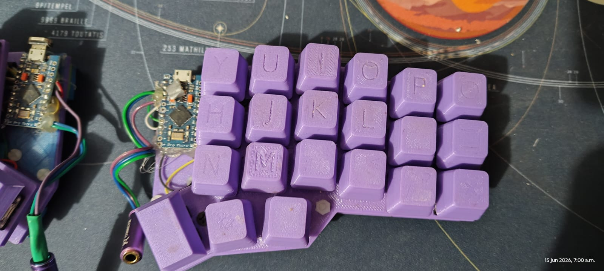 
  <em>Vista superior: keycaps impresos en 3D sobre el plate.</em>

| | | |
|:---:|:---:|:---:|
| 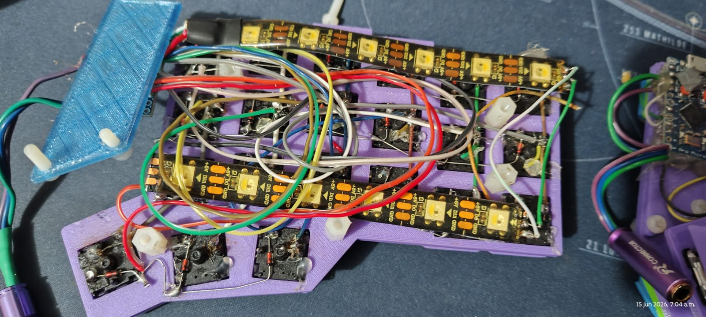 | 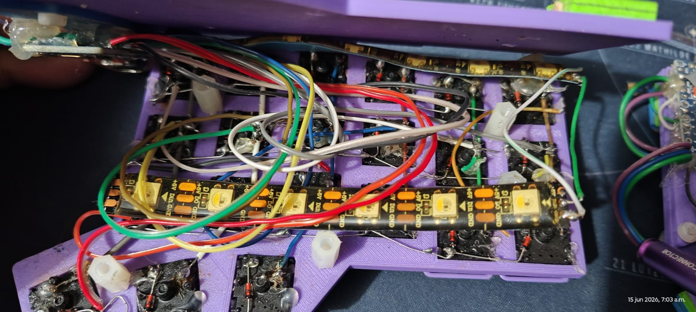 | 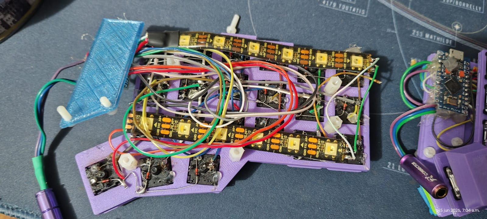 |

### ⭐ Principal: [tecladoMagnetico](https://github.com/robrstein/tecladoMagnetico)

Teclado dividido **Corne (42 teclas) con switches de efecto Hall** (Gateron KS-20 MX) en lugar de switches mecánicos de contacto. Diseño de hardware completo: PCB en KiCad + layout generado con [ergogen](https://github.com/ergogen/ergogen), con firmware **ZMK** para punto de actuación ajustable y *Rapid Trigger*.

- **Sensado:** un sensor Hall analógico DRV5055 por tecla, montado en la cara inferior de la PCB, justo bajo el imán del stem del switch (lee a través de 1.6 mm de FR4).
- **Lectura analógica:** 3× multiplexores SN74LV4051A (8:1) por mitad → solo 3 pines SAADC reales del nRF52840 para 21 teclas.
- **MCU:** nice!nano v2 (nRF52840) en socket, **split 100% inalámbrico por BLE** (sin TRRS), batería LiPo con interruptor.
- **PCB:** una placa por mano (izquierda/derecha), 4 capas (F.Cu / plano GND / plano VCC / B.Cu), DRC limpio y gerbers listos para fabricar (panelizados izquierda + derecha).
- **Firmware:** ZMK con módulos de efecto Hall (`zmk-feature-hall-effect`, `zmk-driver-kscan-he`).
- **Herramientas:** KiCad, ergogen, Python (scripts de post-procesado con `pcbnew`), ZMK.

  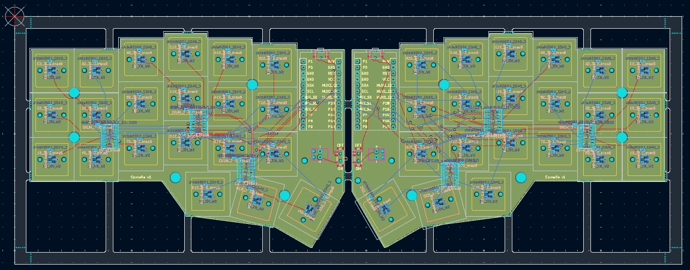 
  <em>Diseño en KiCad: panel con ambas mitades (izquierda y derecha) listo para fabricar.</em>

| Panel final — cara superior (vista 3D KiCad) | Panel final — cara inferior (sensores y multiplexores) |
|:---:|:---:|
| 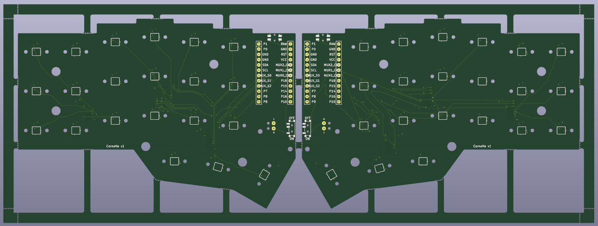 | 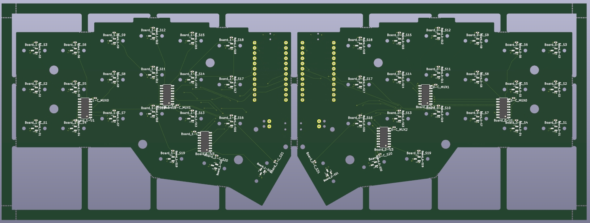 |

| Mitad izquierda — cara superior | Mitad izquierda — cara inferior (sensores y multiplexores) |
|:---:|:---:|
| 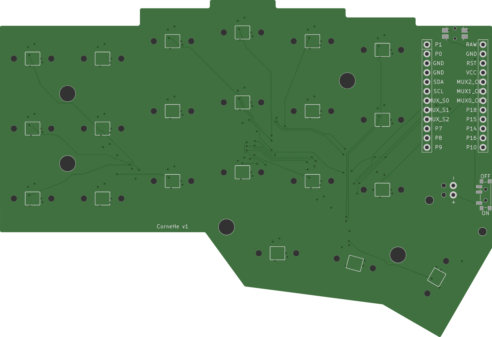 | 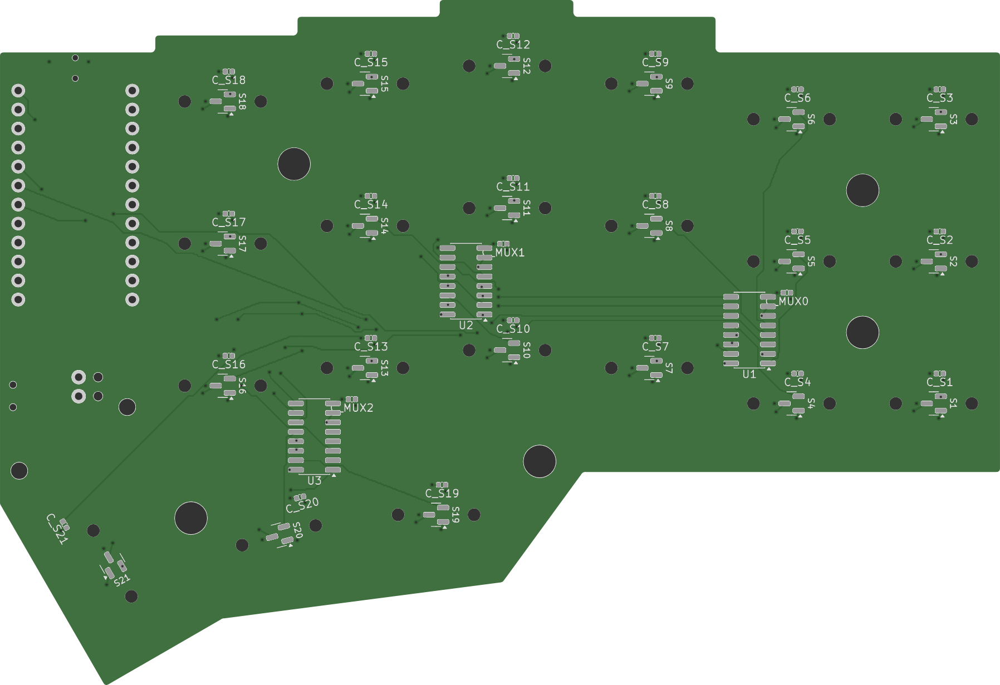 |

  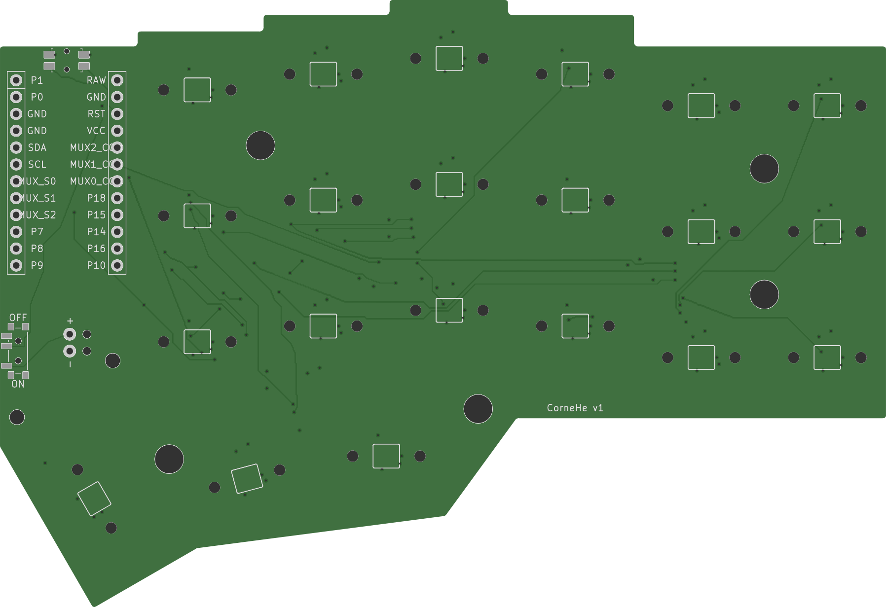 
  <em>Mitad derecha: layout espejado (no se voltea la placa, para mantener el sensor en la cara opuesta al switch).</em>

> Las vistas por mitad son renders generados desde los gerbers de fabricación del repositorio.

### Otros repositorios (forks y relacionados)

- [vial-qmk](https://github.com/robrstein/vial-qmk)  
  Fork de QMK con características específicas de Vial.  
  **Lenguajes:** C, C++, Python, Go, Assembly, Shell, Makefile, AutoHotkey, SourcePawn, Nix, Dockerfile, Roff

- [qmk_firmware](https://github.com/robrstein/qmk_firmware)  
  Firmware open-source para teclados AVR y ARM USB.  
  **Lenguajes:** C, C++, Python, Assembly, Shell, Makefile, Go, AutoHotkey, SourcePawn, Nix, Dockerfile, Roff

- [crkbd](https://github.com/robrstein/crkbd)  
  Teclado dividido Corne.  
  **Lenguajes:** Makefile

- [Lily58](https://github.com/robrstein/Lily58)  
  Teclado dividido 6×4+4 teclas.  
  **Lenguajes:** —

- [zmk](https://github.com/robrstein/zmk)  
  Repositorio de firmware ZMK.  
  **Lenguajes:** C, Python, Shell, CMake, JavaScript, Dockerfile

- [zmk-studio](https://github.com/robrstein/zmk-studio)  
  Herramientas para ZMK Studio.  
  **Lenguajes:** TypeScript, Rust, JavaScript, CSS, HTML, Dockerfile

- [zmk-corne-test3](https://github.com/robrstein/zmk-corne-test3)  
  Test de firmware ZMK para teclado Corne.  
  **Lenguajes:** —

  
🚀 Impresión 3D (repositorios fork)

## 🚀 Impresion 3D

- [Marlin](https://github.com/robrstein/Marlin)  
  Firmware optimizado para impresoras 3D RepRap.  
  **Lenguajes:** C++, C, Python, Shell, Makefile, HTML, CSS, JavaScript, Assembly, OpenSCAD, G-code

- [SuperSlicer](https://github.com/robrstein/SuperSlicer)  
  Generador de G-code para impresoras 3D.  
  **Lenguajes:** C++, C, Perl, Python, JavaScript, HTML, CSS, Shell, Makefile, GLSL, Objective-C, Roff, Lex, Yacc, M4, XSLT

  
🚀 Otros (repositorios fork)

## 🚀 Otros

- [jquery-table2excel](https://github.com/robrstein/jquery-table2excel)  
  Plugin jQuery para exportar tablas HTML a Excel.  
  **Lenguajes:** JavaScript

- [Qprog_T6](https://github.com/robrstein/Qprog_T6)  
  Proyecto de programación T6.  
  **Lenguajes:** Java

- [LibreELEC.tv](https://github.com/robrstein/LibreELEC.tv)  
  Sistema operativo minimalista para KODI.  
  **Lenguajes:** Shell, Python, C, CSS, Makefile, HTML, CMake, Dockerfile

- [transbank-sdk-python](https://github.com/robrstein/transbank-sdk-python)  
  SDK oficial de Transbank para Python.  
  **Lenguajes:** Python, Shell, Makefile, Dockerfile

- [transbank-sdk-dotnet](https://github.com/robrstein/transbank-sdk-dotnet)  
  SDK oficial de Transbank para .NET (C#).  
  **Lenguajes:** C#, PowerShell

- [Quantum-Computing](https://github.com/robrstein/Quantum-Computing)  
  Documentos y archivos del grupo de investigación QM.  
  **Lenguajes:** Jupyter Notebook

---

---

## 📊 Actividad Tecnológica (1999–2026)

Cada celda es un año; mientras más meses de uso de la tecnología (sumando sistemas y proyectos simultáneos), más intenso el color.

  

---

## 🛠 Stack Tecnológico
- **Lenguajes:** Python, C#, SQL/PLSQL 
- **Frameworks:** FastAPI, .NET, ASP.NET, Flutter  
- **Herramientas:** Git, Oracle
- **Intereses:** App publishing, seguridad, optimización de emuladores

---

## 📫 Contacto
- 📧 Email: roberto.escobar.wall@gmail.com  
- 🐙 [GitHub](https://github.com/robrstein)
---
---
 
## 🎵 Música & Videos
- [Perfil en Spotify](https://open.spotify.com/intl-es/artist/6pxXYSk1spPf6xt1tjU7gX/discography/all)  
- [Canal en YouTube](https://www.youtube.com/@robrstein.oficial)

<!--
**robrstein/robrstein** is a ✨ _special_ ✨ repository because its `README.md` (this file) appears on your GitHub profile.

Here are some ideas to get you started:

- 🔭 I’m currently working on ...
- 🌱 I’m currently learning ...
- 👯 I’m looking to collaborate on ...
- 🤔 I’m looking for help with ...
- 💬 Ask me about ...
- 📫 How to reach me: ...
- 😄 Pronouns: ...
- ⚡ Fun fact: ...
-->

